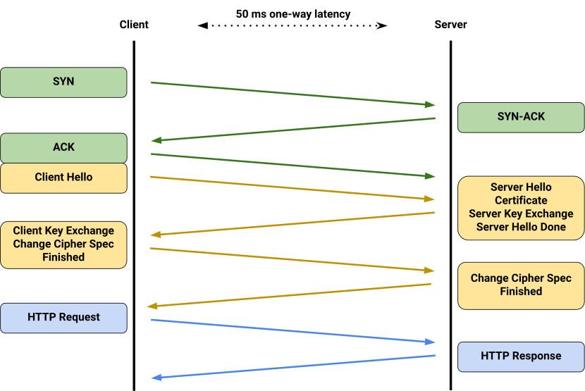
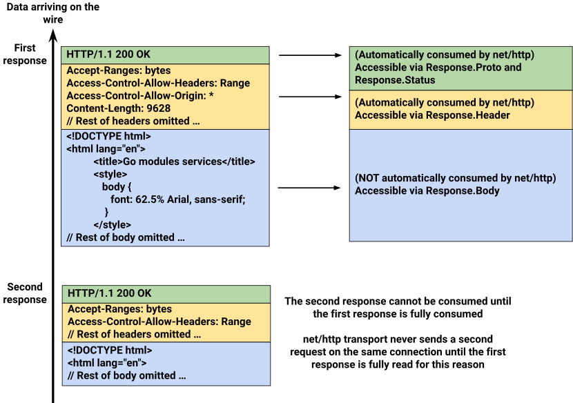

Take a look at the following function:

```go
func getStatus(url string) (int, error) {
	resp, err := http.Get(url)
	if err != nil {
		return 0, err
	}
	defer resp.Body.Close()
	return resp.StatusCode, nil
}
```

It sends a `GET` request to `url` and returns the HTTP status code.

Using HTTP/1 (`GODEBUG=http2client=0`), calling this function 100 times against
[index.golang.org](https://index.golang.org) takes ~710 milliseconds on Go 1.26
on my machine. On Go 1.27, the same program takes ~150 milliseconds.

That is almost 5 times faster! How is such a drastic performance difference
possible?

## The cost of establishing HTTP connections

To understand the difference, consider what happens on the network when we make
an HTTP request.

Go's [`net/http`](/pkg/net/http) package supports HTTP/1.0, HTTP/1.1, and
HTTP/2. All three run over TCP, and usually over TLS when talking to HTTPS
endpoints. Making a request over a new connection looks something like this:



1.  **TCP handshake (1 RTT)**: the client sends a `SYN` packet, the server
    replies with `SYN-ACK`, and the client replies with `ACK`. Because the
    client can send the first TLS message alongside that final `ACK`,
    establishing the TCP connection takes 1 round-trip time (RTT).
2.  **TLS handshake (2 RTT)**: next, a TLS handshake exchanges encryption keys
    and verifies the server's identity; using TLS 1.2, this takes 2 RTT.
3.  **HTTP request**: with the keys exchanged, HTTP requests can finally be sent
    after a total of 3 RTT.

These round trips (plus some CPU time spent on TLS handshakes) add up quickly.
In cross-region communications, one-way latencies often reach or exceed the 50
ms (100 ms RTT) shown in the diagram above. Compared to the 300 ms spent just
setting up the connection, the HTTP request itself can be cheap to serve, taking
only a little over 1 RTT when bandwidth is plentiful or the HTTP response is
small.

Even in more favorable conditions, opening a new connection can still be
expensive. Our opening benchmark queries
[index.golang.org](https://index.golang.org), which is distributed worldwide and
supports TLS 1.3. This means that latency is relatively low, and the TLS
handshake can actually finish in just 1 RTT. Even so, the performance difference
is still very noticeable.

## Connection reuse

To avoid paying this setup cost on every request, HTTP clients and servers try
to reuse existing connections across multiple requests when possible. The
mechanics of this differ based on the HTTP version:

-   **HTTP/1.0**: while not part of the official specification, clients and
    servers often opt into connection reuse by sending a `Connection:
    keep-alive` header. Reuse continues until either endpoint omits the header
    or sends a `Connection: close` header.
-   **HTTP/1.1**: connections are persistent by default, and can be reused for
    subsequent requests and responses unless either side declares otherwise by
    sending a `Connection: close` header.
-   **HTTP/2**: multiple requests and responses can be multiplexed over a single
    TCP connection.

## When connection reuse fails

In HTTP/1 (both HTTP/1.0 and HTTP/1.1), multiple requests and responses on the
same connection are sent sequentially on the wire. If two `GET` requests are
sent to [index.golang.org](https://index.golang.org) over the same TCP
connection, the responses arrive as a single stream of bytes:



As shown in the diagram, [`net/http.Get`](/pkg/net/http#Get) reads and parses
the status line and headers from the byte stream to populate
[`net/http.Response`](/pkg/net/http#Response), then returns immediately. The
response body remains unread on the connection and is consumed only as the
caller reads from [`net/http.Response.Body`](/pkg/net/http#Response.Body).

Because responses are sent back-to-back on the same stream,
[`net/http`](/pkg/net/http) can only find the start of the next response after
the current response body has been read to the very end (as determined by the
`Content-Length` or `Transfer-Encoding` header).

Now look back at our example program, where we never read `resp.Body`:

```go
func getStatus(url string) (int, error) {
	resp, err := http.Get(url)
	if err != nil {
		return 0, err
	}
	defer resp.Body.Close()
	return resp.StatusCode, nil
}
```

Through Go 1.26, when `resp.Body.Close` is called, [`net/http`](/pkg/net/http)
sees that there is still an unread response body. Realizing that it cannot reuse
the connection, it abandons the existing connection and creates new connections
for its next requests, causing it to repeatedly incur the cost of establishing
new connections.

(HTTP/2 does not have this problem. Because it multiplexes streams of frames
over a single connection rather than sending responses strictly back-to-back, an
unread response body on one stream does not block other requests from sharing
the connection.)

## Where failed connection reuse hurts

This subtlety of HTTP/1 connection reuse can cause silent performance
degradation in seemingly innocuous code.

As in our opening example, a client might only care about an API response's
status code. However, the API endpoint it is talking to might send bodies that
provide more detailed but ultimately unused information, such as `{"success":
true, "message": "update processed"}`. This will unfortunately cause connection
reuse to fail.

Even programs that do read the response body can run into this issue if they
stop just short of the end of the body. For example,
[`encoding/json.Decoder`](/pkg/encoding/json#Decoder) stops reading as soon as
it sees the closing `}` of a JSON object. If a server sends a JSON response
terminated with a newline, decoding the JSON object will leave the newline still
unread. The connection cannot be reused for a new request until that newline is
consumed. Thus, a healthy connection might end up being abandoned, even though
it was only a single byte away from being reusable.

## The manual solution

The unread body problem has been a long-standing sharp edge. Over the years,
many Go developers came up with their own workarounds. Most commonly, this is
done by draining the response body prior to closing it:

```go
func getStatus(url string) (int, error) {
	resp, err := http.Get(url)
	if err != nil {
		return 0, err
	}
	drainAndCloseBody(resp.Body)
	return resp.StatusCode, nil
}

func drainAndCloseBody(body io.ReadCloser) {
	io.Copy(io.Discard, body) // Drain the response body before closing it.
	body.Close()
}
```

While this works for small responses, if the unread body is large, establishing
a new TCP connection can be faster than downloading and discarding the rest of
the body. A better approach is to cap the number of bytes we are willing to
drain:

```go
func drainAndCloseBody(body io.ReadCloser) {
	io.CopyN(io.Discard, body, 256<<10) // Only drain up to 256 KB.
	body.Close()
}
```

However, a server might send a response body that trickles in slowly, so we also
need to cap the time we spend draining:

```go
func drainAndCloseBody(body io.ReadCloser) {
	drainDone := make(chan struct{}, 1)
	go func() {
		io.CopyN(io.Discard, body, 256<<10) // Only drain up to 256 KB.
		drainDone <- struct{}{}
	}()
	// Only spend at most 50 ms trying to drain the response body.
	select {
	case <-drainDone:
	case <-time.After(50 * time.Millisecond):
		// If we reach the 50 ms timeout, body.Close will run and interrupt the
		// io.CopyN, preventing goroutine leaks.
	}
	body.Close()
}
```

Of course, we also do not want to block for up to 50 milliseconds when closing a
response body. Instead, we can drain the body asynchronously in the background
and let it race against subsequent requests:

```go
func drainAndCloseBody(body io.ReadCloser) {
	drainDone := make(chan struct{}, 1)
	go func() {
		io.CopyN(io.Discard, body, 256<<10) // Only drain up to 256 KB.
		drainDone <- struct{}{}
	}()
	go func() {
		// Only spend at most 50 ms trying to drain the response body.
		select {
		case <-drainDone:
			// If the drain can finish before a new request is sent, the
			// connection will be reused; otherwise, a new connection is
			// created, and the current connection will be put in a pool of
			// idle connections, potentially being reused for another future
			// request.
		case <-time.After(50 * time.Millisecond):
			// If we reach the 50 ms timeout, body.Close will run and interrupt
			// the io.CopyN, preventing goroutine leaks.
		}
		body.Close()
	}()
}
```

As we can see, draining response bodies safely is surprisingly tricky and
cumbersome. Worse, as the practice of draining response bodies spread, some
nuances were often lost. This has led to misunderstandings such as attempting to
drain response bodies for HTTP/2 connections, when doing so is unnecessary.

## The current state and conclusion

Starting in Go 1.27, [`net/http.Transport`](/pkg/net/http#Transport)
automatically does everything we have implemented in the code above: it will
asynchronously drain an unread HTTP/1 response body for up to 50 ms or 256 KB.
It also implements additional optimizations; for example, when a response
contains the `Connection: close` header, draining the body is guaranteed to be
wasted work, and it therefore skips doing so. Note that this behavior might
evolve in future versions of Go, as other possible enhancements become apparent.

As a general best practice, we now recommend that users simply close their HTTP
bodies once they no longer need them, like in our original example:

```go
func getStatus(url string) (int, error) {
	resp, err := http.Get(url)
	if err != nil {
		return 0, err
	}
	defer resp.Body.Close()
	return resp.StatusCode, nil
}
```

Go is all about simplicity. Let your code stay clean and simple, and let
[`net/http`](/pkg/net/http) deal with the complexities on your behalf.
