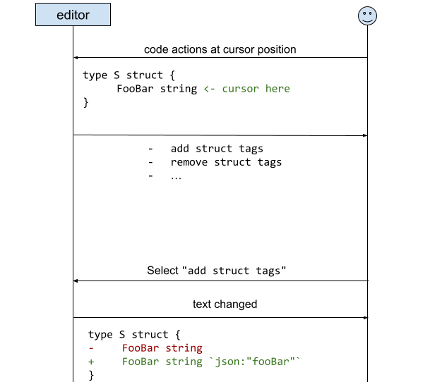
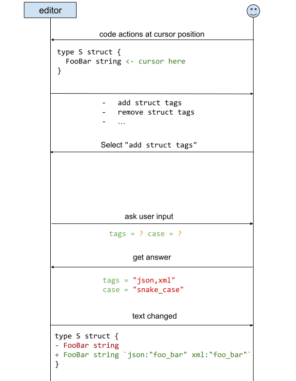

<style>
.beforeafter {
  justify-content: center;
  display: grid;
  gap: 1em;
  margin: 1em 0;
  grid-template-columns: minmax(min-content, 1fr) auto minmax(min-content, 1fr);
  font-size: 100%;
  @media screen and (max-width: 57.7rem) {
    grid-template-columns: 1fr;
  }
}
#content .beforeafter pre {
  margin: 0em;
}
.beforeafter-context {
  grid-column: 1 / -1;
}
#content .beforeafter > pre:nth-of-type(1) { background: var(--color-diff-old); }
#content .beforeafter > pre:nth-of-type(2) { background: var(--color-diff-new); }
.beforeafter-arrow {
  place-self: center;
  margin: -0.5em;
}
.beforeafter-arrow::before {
  content: "⟶";
  @media screen and (max-width: 57.7rem) {
    content: "⇓";
  }
}
#blog #content .blog-image,
#content .blog-image {
  max-width: 60%;
  height: auto;
  border-radius: 6px;
  box-shadow: 0 4px 12px rgba(0,0,0,0.1);
  margin: 1em auto;
  display: block;
}
</style>

When editing code in a modern IDE or editor, developers rely on its refactoring
features to automate common transformations. Today, we are excited to introduce
**interactive refactoring** in [gopls](/gopls), powered by a new capability we are
proposing for the [Language Server Protocol (LSP)](https://microsoft.github.io/language-server-protocol/)
that brings dynamic, multi-step dialogs directly into your favorite editor.
Crucially, we designed this capability (in collaboration with the Dart team)
not just for Go, but as an open standard for all programming languages and
editor ecosystems. Working support is already available in gopls [v0.24.0](/gopls/release/v0.24.0) and
the official Go extension for VS Code v0.56.0.

### What is the Language Server Protocol (LSP)?

The LSP is an open standard that decouples language-specific
features from specific text editors. As you navigate and edit code, your
editor (such as VS Code, Neovim, or Emacs) and a language server (like gopls)
engage in a continuous JSON-RPC exchange to provide features like autocomplete,
hover documentation, diagnostics, and code actions.

### Multi-step code transformation

Today, almost every code transformation in the LSP is like a function of no
parameters: you trigger the operation, and the server immediately computes the
edits. (Renaming a symbol is the sole exception: because it is a function of one
parameter, the desired new name, it required its own dedicated `PrepareRename`
RPC in the protocol.)

<center>
  
  <p><em>"Add struct tags", without questions</em></p>
</center>

The language server must deduce the user's intent from context alone, namely
the cursor position and the enclosing syntax tree. When that context is not
enough, the server is forced into one of two choices: apply a one-size-fits-all
default, or refrain from offering the transformation altogether. The limitation
lies not in gopls's ability to compute the necessary edits, but in the
LSP's lack of a mechanism for language servers to ask the user for input.

For many transformations, this parameterless model works well. But many others
need additional input from the user: which struct tags to add and in what
naming convention, which interface to implement, which file to move a
declaration to. Without a way to ask, gopls could only guess—"Add struct
tags", for example, always produced `json` tags in `camelCase`—or not offer the
refactoring at all. With interactive refactoring, language servers can now
easily provide new operations with one or more parameters.

<center>
  
  <p><em>"Add struct tags", with questions</em></p>
</center>

While some language extensions have worked around this limitation by embedding
custom, language-specific dialog logic directly into individual editors, doing
so leaves behind other editors (such as Neovim and Emacs) that stick strictly
to the LSP with minimal custom client code. More importantly, editor-specific
workarounds go against the fundamental purpose of the LSP: to decouple
language-specific features from editors so that each server improvement benefits
every client.

Our [LSP interactive refactoring proposal](https://go.googlesource.com/proposal/+/refs/heads/master/design/76331-lsp-interactive-refactoring.md)
([microsoft/language-server-protocol#1164](https://github.com/microsoft/language-server-protocol/issues/1164))
solves this by establishing a standard mechanism for
language servers to collect user input before computing text edits. For Go
developers, this unlocks a suite of long-awaited refactorings, including:
- [golang/go#70583](/issue/70583): Move Declaration
- [golang/go#38028](/issue/38028): Change Signature
- [golang/vscode-go#1547](https://github.com/golang/vscode-go/issues/1547): Implement Interface
- [golang/vscode-go#2002](https://github.com/golang/vscode-go/issues/2002): Modify Struct Tags

among many others.

## Interactive refactorings in action

**Adding and removing struct tags (gopls v0.23.0)**

When configuring serialization formats, developers frequently need custom tags
and casing conventions. Previously, running "Add struct tags" unconditionally
injected `json` tags using `camelCase` formatting.

With interactive refactoring:

1. Place your cursor on any struct definition and select the
   **"Add struct tags"** code action.
2. An input dialog appears, pre-filled with `json`, allowing you to customize
   any combination of tags (such as `json,yaml,db`).
3. A second dialog lets you select your desired naming convention (such as
   `camelCase`, `snake_case`, or `PascalCase`).
4. Gopls generates and applies the formatted struct tags across your type
   definition.

<center>
  <video class="blog-image" controls loop muted playsinline
         src="interactive-refactoring/interactive-go-add-struct-tags.webm"
         title="Interactive Add struct tags in VS Code"></video>
  <p><em>Interactive "Add struct tags" in VS Code</em></p>
</center>

Here is the before-and-after transformation:

<div class="beforeafter">

```go
type UserProfile struct {
	ID        int64
	FirstName string
	LastName  string
	EmailAddr string
}
```

<div class="beforeafter-arrow"></div>

```go
type UserProfile struct {
	ID        int64  `json:"id" db:"id"`
	FirstName string `json:"first_name" db:"first_name"`
	LastName  string `json:"last_name" db:"last_name"`
	EmailAddr string `json:"email_addr" db:"email_addr"`
}
```

</div>

Similarly, **"Remove struct tags"** now asks you for the specific tag keys
you wish to delete (for example, removing only `db` tags while preserving the `json`
tag), rather than wiping out all struct tags indiscriminately.

<center>
  <video class="blog-image" controls loop muted playsinline
         src="interactive-refactoring/interactive-go-remove-struct-tags.webm"
         title="Interactive Remove struct tags in VS Code"></video>
  <p><em>Interactive "Remove struct tags" in VS Code</em></p>
</center>

**Implementing interfaces with dynamic symbol search**

When creating a type to satisfy an interface, developers previously had to copy
the interface declaration and manually turn it into a set of methods on the
receiver type (or rely on external tools like `impl` by manually typing the
receiver and qualifying the name of the interface).

Since gopls v0.23.0, with interactive refactoring:

1. Place your cursor on any concrete type and select the
   **"Add methods to X to implement an interface..."** code action.
2. A text entry field appears, inviting you to choose the name of an interface
   type. It makes dynamic queries to gopls to auto-complete names of types in
   your workspace and the standard library (for example, `maphash.Hasher`).
3. If the selected interface has type parameters, gopls asks for a
   concrete type argument for each type parameter (such as `Foo`).
4. Gopls generates complete method stubs with appropriate receiver names and
   instantiated method signatures.

<center>
  <video class="blog-image" controls loop muted playsinline
         src="interactive-refactoring/interactive-go-implement-interface.webm"
         title="Interactive interface implementation in VS Code"></video>
  <p><em>Interactive "Add methods to implement an interface..." in
     VS Code</em></p>
</center>

<div class="beforeafter">

```go
type Foo struct{}

type MyHasher struct{}
```

<div class="beforeafter-arrow"></div>

```go
type Foo struct{}

type MyHasher struct{}

// Equal implements [maphash.Hasher].
func (m *MyHasher) Equal(x Foo, y Foo) bool {
	panic("unimplemented")
}

// Hash implements [maphash.Hasher].
func (m *MyHasher) Hash(*maphash.Hash, Foo) {
	panic("unimplemented")
}
```

</div>

**Moving declarations across files and packages (preview)**

Moving declarations manually by cutting and pasting can easily break references
and requires tedious import cleanup across multiple files. While scheduled for
an upcoming gopls release, our working implementation already demonstrates how
interactive file selection streamlines cross-file and cross-package moves:

1. Place your cursor on any top-level declaration and select the
   **"Move declaration X"** code action.
2. A file picker dialog lets you choose an existing destination `.go` file or
   specify a new file path.
3. Gopls moves the declaration along with its dependent declarations (such as
   unexported helpers or methods) while leaving unrelated symbols in place,
   updates references across your workspace, and cleans up imports in both the
   source and destination files.

<center>
  <video class="blog-image" controls loop muted playsinline
         src="interactive-refactoring/interactive-go-move-decl.webm"
         title="Interactive Move declaration in VS Code"></video>
  <p><em>Interactive "Move declaration" in VS Code</em></p>
</center>

In the example below, we move the type `Foo` from package `from` to package
`to`. Its method `Print` and the unexported constant `bar`, which only `Foo`
uses, move along with it, while the unrelated function `Baz` stays behind:

<div class="beforeafter">

```go
// from/from.go
package from

import (
	"fmt"
	"strings"
)

const bar = "bar"

// Doc comment for Foo
type Foo struct{}

func (f Foo) Print() {
	fmt.Println(bar)
}

func Baz() string {
	return strings.ToUpper("baz")
}
```

<div class="beforeafter-arrow"></div>

```go
// from/from.go
package from

import "strings"

func Baz() string {
	return strings.ToUpper("baz")
}

// to/to.go
package to

import "fmt"

const bar = "bar"

// Doc comment for Foo
type Foo struct{}

func (f Foo) Print() {
	fmt.Println(bar)
}
```

</div>

**Slaying the dragon (gopls v0.24.0)**

As a demonstration of multi-step interactive dialogs and a self-contained test
case for client editor implementations, gopls v0.24.0 offers a **"Slay the
dragon"** code action when you place your cursor on a package-level variable
named `dragonSlayer` (for example, `var dragonSlayer string`). Happy hunting!

## What’s on the Horizon

Interactive refactoring establishes a foundational capability in gopls,
opening up several exciting directions on our roadmap:

- **Change signature refactoring ([#38028](/issue/38028))**: Adding, removing,
  or reordering function parameters across a workspace requires input that
  cannot be deduced from syntax alone, such as the new parameter order or the
  default argument expression to insert at existing call sites. Interactive
  forms allow gopls to collect these details before rewriting the declaration
  and all call sites.
- **Interactive conflict resolution**: When a code transformation encounters
  naming collisions, identifier shadowing, or ambiguous references, gopls can
  ask the user for guidance, such as asking for permission to proceed or
  offering to rename conflicting symbols on the fly.
- **Interactive commands beyond code edits**: Because interactivity is modeled
  at the LSP [command](https://microsoft.github.io/language-server-protocol/specifications/lsp/3.17/specification/#command)
  layer, it naturally generalizes to non-edit server
  operations that require user configuration, such as configuring test or
  benchmark runs with profiling flags (CPU, memory, tracing).

## Getting Started and Sharing Feedback

Interactive refactoring is available in gopls [v0.24.0](/gopls/release/v0.24.0)
and `vscode-go` [v0.56.0](https://github.com/golang/vscode-go/releases/tag/v0.56.0)
(with proof-of-concept client integrations also explored for
[Neovim](https://github.com/h9jiang/neovim/tree/interactive-refactoring) and
[Emacs](https://go-review.googlesource.com/c/tools/+/800220)).

We would love to hear your thoughts as we continue
refining interactive code actions in gopls:

- For general feedback or feature requests, file an issue on the [Go issue tracker](/issue/new).
- To read the full technical specification—including the stateless form
  protocol design and alternative approaches we explored—or to join the
  discussion with the broader LSP community, check out the
  [LSP Interactive Code Actions design document](https://go.googlesource.com/proposal/+/refs/heads/master/design/76331-lsp-interactive-refactoring.md)
  and the ongoing conversation in [microsoft/language-server-protocol#1164](https://github.com/microsoft/language-server-protocol/issues/1164).

*(Special thanks to Alan Donovan, Alex Putman, Brian Wilkerson, Danny Tuppeny,
Hana Kim, Madeline Kalil, Peter Weinberger, and Robert Findley for their
insights, discussions, feedback, and collaboration on this work.)*

Happy refactoring!
