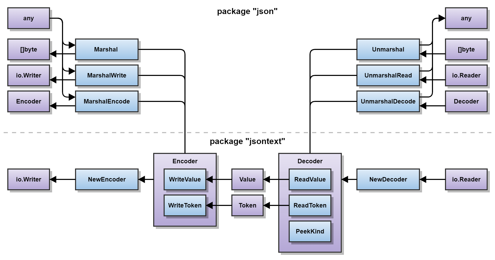

## Introduction

[JavaScript Object Notation (JSON)](https://datatracker.ietf.org/doc/html/rfc8259) is a simple data interchange format, the most popular data format used on the internet, and widely read and written by Go programs.
Go has included support for JSON in the standard library since well before Go 1.0.
We first we wrote about [support for JSON in Go](/blog/json) more than 15 years ago!

Over time, packages evolve with the needs of their users, and `encoding/json` is no exception.
Last year, we wrote about a [new experimental API for JSON](/blog/jsonv2-exp) designed to bring long-awaited improvements and fixes.

After additional feedback and refinement, the new `encoding/json/v2` and `encoding/json/jsontext` packages are stable and generally available in Go 1.27!
This post is an updated version of the [article introducing the experiment](/blog/jsonv2-exp), describing the problems with `encoding/json`, and an introduction to the new packages.

## Problems with `encoding/json`

Overall, `encoding/json` has held up well.
The idea of marshaling and unmarshaling arbitrary Go types
with some default representation in JSON, combined with the ability to
customize the representation, has proven to be highly flexible.
However, in the years since its introduction,
various users have identified numerous shortcomings.

### Behavior flaws

There are various behavioral flaws in `encoding/json`:

* **Imprecise handling of JSON syntax**: Over the years, JSON has seen
increased standardization in order for programs to properly communicate.
Generally, decoders have become stricter at rejecting ambiguous inputs,
to reduce the chance that two implementations will have different
(successful) interpretations of a particular JSON value.

    * `encoding/json` currently accepts invalid UTF-8,
    whereas the latest Internet Standard (RFC 8259) requires valid UTF-8.
    The default behavior should report an error in the presence of invalid UTF-8,
    instead of introducing silent data corruption,
    which may cause problems downstream.

    * `encoding/json` currently accepts objects with duplicate member names.
    RFC 8259 does not specify how to handle duplicate names,
    so an implementation is free to choose an arbitrary value,
    merge the values, discard the values, or report an error.
    The presence of a duplicate name results in a JSON value
    without a universally agreed upon meaning.
    This could be [exploited by attackers in security applications](https://www.youtube.com/watch?v=avilmOcHKHE&t=1057s)
    and has been exploited before (as in [CVE-2017-12635](https://nvd.nist.gov/vuln/detail/CVE-2017-12635)).
    The default behavior should err on the side of safety and reject duplicate names.

* **Leaking nilness of slices and maps**: JSON is often used to communicate with
programs using JSON implementations that do not allow `null` to be unmarshaled
into a data type expected to be a JSON array or object.
Since `encoding/json` marshals a nil slice or map as a JSON `null`,
this may lead to errors when unmarshaling by other implementations.
[A survey](/issue/63397#discussioncomment-7201222)
indicated that most Go users prefer that nil slices and maps
are marshaled as an empty JSON array or object by default.

* **Case-insensitive unmarshaling**: When unmarshaling, a JSON object member name
is resolved to a Go struct field name using a case-insensitive match.
This is a surprising default, a potential security vulnerability, and a performance limitation.

* **Inconsistent calling of methods**: Due to an implementation detail,
`MarshalJSON` methods declared on a pointer receiver
are [inconsistently called by `encoding/json`](/issue/22967). While regarded as a bug,
this cannot be fixed as too many applications depend on the current behavior.

### API deficiencies

The API of `encoding/json` can be tricky or restrictive:

* It is difficult to correctly unmarshal from an `io.Reader`.
Users often write `json.NewDecoder(r).Decode(v)`,
which fails to reject trailing junk at the end of the input.

* Options can be set on the `Encoder` and `Decoder` types,
but cannot be used with the `Marshal` and `Unmarshal` functions.
Similarly, types implementing the `Marshaler` and `Unmarshaler` interfaces
cannot make use of the options and there is no way to plumb options down the call stack.
For example, the `Decoder.DisallowUnknownFields` option loses its effect
when calling a custom `UnmarshalJSON` method.

* The `Compact`, `Indent`, and `HTMLEscape` functions write to a `bytes.Buffer`
instead of something more flexible like a `[]byte` or `io.Writer`.
This limits the usability of those functions.

### Performance limitations

Setting aside internal implementation details,
the public API commits it to certain performance limitations:

* **MarshalJSON**: The `MarshalJSON` interface method forces the implementation
to allocate the returned `[]byte`. Also, the semantics require that
`encoding/json` verify that the result is valid JSON
and also to reformat it to match the specified indentation.

* **UnmarshalJSON**: The `UnmarshalJSON` interface method requires that
a complete JSON value be provided (without any trailing data).
This forces `encoding/json` to parse the JSON value to be unmarshaled
in its entirety to determine where it ends before it can call `UnmarshalJSON`.
Afterwards, the `UnmarshalJSON` method itself must parse the provided JSON value again.

* **Lack of streaming**: Even though the `Encoder` and `Decoder` types operate
on an `io.Writer` or `io.Reader`, they buffer the entire JSON value in memory.
The `Decoder.Token` method for reading individual tokens is allocation-heavy
and there is no corresponding API for writing tokens.

Furthermore, if the implementation of a `MarshalJSON` or `UnmarshalJSON` method
recursively calls the `Marshal` or `Unmarshal` function,
then the performance becomes quadratic.

## Trying to fix `encoding/json` directly

Introducing a new, incompatible major version of a package is a heavy consideration.
If possible, we should try to fix the existing package.

While it is relatively easy to add new features,
it is difficult to change existing features.
Unfortunately, these problems are inherent consequences of the existing API,
making them practically impossible to fix within the [Go 1 compatibility promise](/doc/go1compat).

We could in principle declare separate names, such as `MarshalV2` or `UnmarshalV2`,
but that is tantamount to creating a parallel namespace within the same package.
This leads us to `encoding/json/v2` (henceforth called `v2`),
where we can make these changes within a separate `v2` namespace
in contrast to `encoding/json` (henceforth called `v1`).

## Building on `encoding/json/jsontext`

Before discussing the `v2` API, we first introduce the
[`encoding/json/jsontext`](/pkg/encoding/json/jsontext) package
that lays the foundation for improvements to JSON in Go.

JSON serialization in Go can be broken down into two primary components:

* *syntactic functionality* that is concerned with processing JSON based on its grammar, and
* *semantic functionality* that defines the relationship between JSON values and Go values.

We use the terms "encode" and "decode" to describe syntactic functionality and
the terms "marshal" and "unmarshal" to describe semantic functionality.
We aim to provide a clear distinction between functionality
that is purely concerned with encoding versus that of marshaling.



This diagram provides an overview of this separation.
Purple blocks represent types, while blue blocks represent functions or methods.
The direction of the arrows approximately represents the flow of data.
The bottom half of the diagram, implemented by the `jsontext` package,
contains functionality that is only concerned with syntax,
while the upper half, implemented by the `json/v2` package,
contains functionality that assigns semantic meaning to syntactic data
handled by the bottom half.

The basic API of `jsontext` is the following:

```go
package jsontext

type Encoder struct { ... }
func NewEncoder(io.Writer, ...Options) *Encoder
func (*Encoder) WriteValue(Value) error
func (*Encoder) WriteToken(Token) error

type Decoder struct { ... }
func NewDecoder(io.Reader, ...Options) *Decoder
func (*Decoder) ReadValue() (Value, error)
func (*Decoder) ReadToken() (Token, error)

type Kind byte
type Value []byte
func (Value) Kind() Kind
type Token struct { ... }
func (Token) Kind() Kind
```

The `jsontext` package provides functionality for interacting with JSON
at a syntactic level and derives its name from
[RFC 8259, section 2](https://datatracker.ietf.org/doc/html/rfc8259#section-2)
where the grammar for JSON data is literally called `JSON-text`.
Since it only interacts with JSON at a syntactic level,
it does not depend on Go reflection.

The [`Encoder`](/pkg/encoding/json/jsontext#Encoder) and
[`Decoder`](/pkg/encoding/json/jsontext#Decoder)
provide support for encoding and decoding JSON values and tokens.
The constructors
[accept variadic options](/pkg/encoding/json/jsontext#Options)
that affect the particular behavior of encoding and decoding.
Unlike the `Encoder` and `Decoder` types declared in `v1`,
the new types in `jsontext` avoid muddling the distinction between syntax and
semantics and operate in a truly streaming manner.

A JSON value is a complete unit of data and is represented in Go as
[a named `[]byte`](/pkg/encoding/json/jsontext#Value).
It is identical to [`RawMessage`](/pkg/encoding/json#RawMessage) in `v1`, which is now a type alias to `jsontext.Value`.
A JSON value is syntactically composed of one or more JSON tokens.
A JSON token is represented in Go as the [opaque `Token` type](/pkg/encoding/json/jsontext#Token)
with constructors and accessor methods.
It is analogous to [`Token`](/pkg/encoding/json#Token) in `v1`
but is designed represent arbitrary JSON tokens without allocation.

To resolve the fundamental performance problems with
the `MarshalJSON` and `UnmarshalJSON` interface methods,
we need an efficient way of encoding and decoding JSON
as a streaming sequence of tokens and values.
In `v2`, we introduce the `MarshalJSONTo` and `UnmarshalJSONFrom` interface methods
that operate on an `Encoder` or `Decoder`, allowing the methods' implementations
to process JSON in a purely streaming manner. Thus, the `json` package need not
be responsible for validating or formatting a JSON value returned by `MarshalJSON`,
nor would it need to be responsible for determining the boundaries of a JSON value
provided to `UnmarshalJSON`. These responsibilities belong to the `Encoder` and `Decoder`.

## Introducing `encoding/json/v2`

Building on the `jsontext` package, we now introduce the
[`encoding/json/v2`](/pkg/encoding/json/v2) package.
It is designed to fix the problems in `v1`,
while remaining familiar to users of the `v1` package.
Our goal is that usages of `v1` will operate *mostly* the same if directly migrated to `v2`.

Here, we primarily cover the high-level API of `v2`.
For examples on how to use it, we encourage readers to
study [the examples in the `v2` package](/pkg/encoding/json/v2#pkg-examples),
the "[Working with JSON](/doc/tutorial/json)" tutorial, or
read [Anton Zhiyanov's blog covering the topic](https://antonz.org/go-json-v2/).

The basic API of `v2` is the following:
```go
package json

func Marshal(in any, opts ...Options) (out []byte, err error)
func MarshalWrite(out io.Writer, in any, opts ...Options) error
func MarshalEncode(out *jsontext.Encoder, in any, opts ...Options) error

func Unmarshal(in []byte, out any, opts ...Options) error
func UnmarshalRead(in io.Reader, out any, opts ...Options) error
func UnmarshalDecode(in *jsontext.Decoder, out any, opts ...Options) error
```

The [`Marshal`](/pkg/encoding/json/v2#Marshal)
and [`Unmarshal`](/pkg/encoding/json/v2#Unmarshal) functions
have a signature similar to `v1`, but accept options to configure their behavior.
The [`MarshalWrite`](/pkg/encoding/json/v2#MarshalWrite)
and [`UnmarshalRead`](/pkg/encoding/json/v2#UnmarshalRead) functions
directly operate on an `io.Writer` or `io.Reader`,
avoiding the need to temporarily construct an `Encoder` or `Decoder`
just to write or read from such types.
The [`MarshalEncode`](/pkg/encoding/json/v2#MarshalEncode)
and [`UnmarshalDecode`](/pkg/encoding/json/v2#UnmarshalDecode) functions
operate on a `jsontext.Encoder` and `jsontext.Decoder` and
is actually the underlying implementation of the previously mentioned functions.
Unlike `v1`, options are a first-class argument to each of the marshal and unmarshal functions,
greatly extending the flexibility and configurability of `v2`.
There are [several options available](/pkg/encoding/json/v2#Options)
in `v2` which are not covered by this article.

### Type-specified customization

Similar to `v1`, `v2` allows types to define their own JSON representation
by satisfying particular interfaces.

```go
type Marshaler interface {
	MarshalJSON() ([]byte, error)
}
type MarshalerTo interface {
	MarshalJSONTo(*jsontext.Encoder) error
}

type Unmarshaler interface {
	UnmarshalJSON([]byte) error
}
type UnmarshalerFrom interface {
	UnmarshalJSONFrom(*jsontext.Decoder) error
}
```

The [`Marshaler`](/pkg/encoding/json/v2#Marshaler)
and [`Unmarshaler`](/pkg/encoding/json/v2#Unmarshaler) interfaces
are identical to those in `v1`.
The new [`MarshalerTo`](/pkg/encoding/json/v2#MarshalerTo)
and [`UnmarshalerFrom`](/pkg/encoding/json/v2#UnmarshalerFrom) interfaces
allow a type to represent itself as JSON using a `jsontext.Encoder` or `jsontext.Decoder`.
This allows options to be forwarded down the call stack, since options
can be retrieved via the `Options` accessor method on the `Encoder` or `Decoder`.

See [the `OrderedObject` example](/pkg/encoding/json/v2#example-package-OrderedObject)
for how to implement a custom type that maintains the ordering of JSON object members.

### Caller-specified customization

In `v2`, the caller of `Marshal` and `Unmarshal` can also specify
a custom JSON representation for any arbitrary type,
where caller-specified functions take precedence over type-defined methods
or the default representation for a particular type.

```go
func WithMarshalers(*Marshalers) Options

type Marshalers struct { ... }
func MarshalFunc[T any](fn func(T) ([]byte, error)) *Marshalers
func MarshalToFunc[T any](fn func(*jsontext.Encoder, T) error) *Marshalers

func WithUnmarshalers(*Unmarshalers) Options

type Unmarshalers struct { ... }
func UnmarshalFunc[T any](fn func([]byte, T) error) *Unmarshalers
func UnmarshalFromFunc[T any](fn func(*jsontext.Decoder, T) error) *Unmarshalers
```

[`MarshalFunc`](/pkg/encoding/json/v2#MarshalFunc) and
[`MarshalToFunc`](/pkg/encoding/json/v2#MarshalToFunc)
construct a custom marshaler that can be passed to a `Marshal` call
using `WithMarshalers` to override the marshaling of particular types.
Similarly,
[`UnmarshalFunc`](/pkg/encoding/json/v2#UnmarshalFunc) and
[`UnmarshalFromFunc`](/pkg/encoding/json/v2#UnmarshalFromFunc)
support similar customization for `Unmarshal`.

[The `ProtoJSON` example](/pkg/encoding/json/v2#example-package-ProtoJSON)
demonstrates how this feature allows serialization of all
[`proto.Message`](/pkg/google.golang.org/protobuf/proto#Message) types
to be handled by the [`protojson`](/pkg/google.golang.org/protobuf/encoding/protojson) package.

### Behavior differences

While `v2` aims to behave *mostly* the same as `v1`,
its behavior has changed [in some ways](/pkg/encoding/json#hdr-Migrating_to_v2)
to address problems in `v1`, most notably:

* `v2` reports an error in the presence of invalid UTF-8.

* `v2` reports an error if a JSON object contains a duplicate name.

* `v2` marshals a nil Go slice or Go map as an empty JSON array or JSON object, respectively.

* `v2` unmarshals a JSON object into a Go struct using a
case-sensitive match from the JSON member name to the Go field name.

* `v2` redefines the `omitempty` tag option to omit a field if it would have
encoded as an "empty" JSON value (which are `null`, `""`, `[]`, and `{}`).

* `v2` reports an error when trying to serialize a `time.Duration`,
which currently has [no default representation](/issue/71631),
but provides options to let the caller decide.

For most behavior changes, there is a struct tag option or caller-specified option
that can configure the behavior to operate under `v1` or `v2` semantics,
or even other caller-determined behavior.
See "[Migrating to v2](/pkg/encoding/json#hdr-Migrating_to_v2)" for more information.

### Performance optimizations

The `Marshal` performance of `v2` is roughly at parity with `v1`.
Sometimes it is slightly faster, but other times it is slightly slower.
The `Unmarshal` performance of `v2` is significantly faster than `v1`,
with benchmarks demonstrating improvements of up to 10x.

In order to obtain greater performance gains,
existing implementations of
[`Marshaler`](/pkg/encoding/json/v2#Marshaler) and
[`Unmarshaler`](/pkg/encoding/json/v2#Unmarshaler) should
migrate to also implement
[`MarshalerTo`](/pkg/encoding/json/v2#MarshalerTo) and
[`UnmarshalerFrom`](/pkg/encoding/json/v2#UnmarshalerFrom),
so that they can benefit from processing JSON in a purely streaming manner.
For example, recursive parsing of OpenAPI specifications in `UnmarshalJSON` methods
significantly hurt performance in a particular service of Kubernetes
(see [kubernetes/kube-openapi#315](https://github.com/kubernetes/kube-openapi/issues/315)),
while switching to `UnmarshalJSONFrom` improved performance by orders of magnitude.

For more benchmark details, see the
[`go-json-experiment/jsonbench`](https://github.com/go-json-experiment/jsonbench)
repository.

On top of structural improvements, we're continuing to invest in performance optimizations in the implementation for [cases](/issue/81315) where the `v2` implementation is slower than `v1`.
You can expect additional improvements in Go 1.28.

## Compatibility

The [Go 1 compatibility promise](/doc/go1compat) is a core guarantee from the Go project that allows developers to build applications that will stand the test of time and continue working on future versions of Go.

The original `encoding/json` and new `encoding/json/v2` packages are of course both subject to the Go 1 compatibility promise.
Applications using `v1` will continue to be supported indefinitely and need not ever migrate to `v2`.

That said, when designing the `v2` packages we wanted to do better than keeping `v1` supported.
We wanted to ensure that `v1` and `v2` are _compatible with one another_ so that packages using different versions can work together.
Doing so allows a smooth ecosystem migration rather than forcing users to use one version or another due to the choices of their dependencies.

For instance, suppose your package uses `v2` to marshal a struct containing a field with a type defined in another package.
That package may use the original `v1` [`MarshalJSON`](/pkg/encoding/json/v2#Marshaler) method to define its marshaling behavior.
No problem, `v2` supports [`MarshalJSON`](/pkg/encoding/json/v2#Marshaler) methods, so marshaling will continue working as expected.

Vice versa, suppose your package uses `v1` to marshal the same struct.
The other package may use the `v2` [`MarshalJSONTo`](/pkg/encoding/json/v2#MarshalerTo) method for better performance.
No problem here either, as the `v1` implementation supports `v2`'s [`MarshalJSONTo`](/pkg/encoding/json/v2#MarshalerTo) method under the hood.

We've achieved this by designing the new packages such that, under the hood, `v1` is implemented in terms of `v2`.
As mentioned above, `v2` supports a variety of [`Options`](/pkg/encoding/json/v2#Options).
Each behavior difference is controlled by one of the these options.
Thus, `v1` can be implemented in terms of `v2` by passing the full set of `v1` compatibility options.

With this approach, backwards-compatible additions such as new methods (e.g., [`MarshalJSONTo`](/pkg/encoding/json/v2#MarshalerTo)) or new struct tags (e.g., [`embed`](/pkg/encoding/json/v2#hdr-JSON_Representation_of_Go_structs)) are automatically supported to the benefit of existing `v1` users.

## Migration

Implementing `v1` in terms of `v2` options has the additional benefit of allowing gradual migration of callsites.

`encoding/json` [documents](/pkg/encoding/json#hdr-Migrating_to_v2) the full set of behavior differences between `v1` and `v2`, and which option controls that behaviors.

Many applications can migrate directly to `v2` with no visible behavior changes, but applications that depend on `v1` behavior can use the options to change only the behaviors they depend on.

For example, we can select all `v2` behavior except for allowing duplicate names:
```go
json.Marshal(..., json.DefaultOptionsV2(), jsontext.AllowDuplicateName(true))
```

Alternatively, we can select all `v1` behavior except for disallowing duplicate names:
```go
json.Marshal(..., jsonv1.DefaultOptionsV1(), jsontext.AllowDuplicateName(false))
```

The [`encoding/json/v2` Migration Guide](/doc/jsonv2-migration) goes into more detail, covering a variety of scenarios for approaching migration of an application from `v1` to `v2`.

## More information

For additional references on working with the new JSON packages, see:

* The "[Working with JSON](/doc/tutorial/json)" tutorial,
* The [`encoding/json/v2`](/pkg/encoding/json/v2) and [`encoding/json/jsontext`](/pkg/encoding/json/jsontext) package documentation,
* The [`encoding/json`](/pkg/encoding/json#hdr-Migrating_to_v2) package's `v2` comparison documentation,
* and the [`encoding/json/v2` Migration Guide](/doc/jsonv2-migration).

## A long time coming

The planning for a new major version of `encoding/json` spanned years.
In late 2020, spurred on by the inability to fix issues in the current package,
Daniel Martí (one of the maintainers of `encoding/json`) first drafted his
thoughts on [what a hypothetical `v2` package should look like](https://docs.google.com/document/d/1WQGoM44HLinH4NGBEv5drGlw5_RNW-GP7DdGEpm7Y3o).
Separately, after previous work on the [Go API for Protocol Buffers](/blog/protobuf-apiv2),
Joe Tsai was disappointed that [the `protojson` package](/pkg/google.golang.org/protobuf/encoding/protojson)
needed to use a custom JSON implementation because `encoding/json` was
neither capable of adhering to the stricter JSON standard that the
Protocol Buffer specification required,
nor of efficiently serializing JSON in a streaming manner.

Believing a brighter future for JSON was both beneficial and achievable,
Daniel and Joe joined forces to brainstorm on `v2` and
[started to build a prototype](https://github.com/go-json-experiment/json)
(with the initial code being a polished version of the JSON serialization logic from the Go protobuf module).
Over time, a few others (Roger Peppe, Chris Hines, Johan Brandhorst-Satzkorn, Damien Neil, Austin Clements, and Michael Pratt)
joined the effort by providing design review, code review, and regression testing.
Many of the early discussions are publicly available in our
[recorded meetings](https://www.youtube.com/playlist?list=PLZgrQPcV8W8EChkaAvv-3NUu6PYmnGG3b) and
[meeting notes](https://docs.google.com/document/d/1rovrOTd-wTawGMPPlPuKhwXaYBg9VszTXR9AQQL5LfI).
Later discussions are available in our [`encoding/json/v2` working group meeting notes](/issue/76406).

This work has been public since the beginning,
and we increasingly involved the wider Go community,
first with a
[GopherCon talk](https://www.youtube.com/watch?v=avilmOcHKHE) and
[discussion posted in late 2023](/issue/63397),
[formal proposal posted in early 2025](/issue/71497),
and finally [adopting `encoding/json/v2` as a Go experiment in Go 1.25](/issue/71845)
for wider-scale testing by all Go users.

The `v2` effort took about 6 years to reach this point,
incorporating feedback from many contributors and also gaining valuable
empirical experience from use in production settings.

It's worth noting that it's largely been developed and promoted by people
not employed by Google, demonstrating that the Go project is a collaborative endeavor
with a thriving global community dedicated to improving the Go ecosystem.

Thank you to everyone that contributed!
